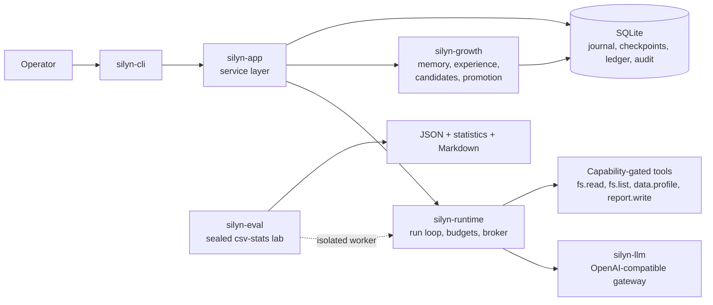

# Silyn

Silyn is a self-evolving AI agent. It accumulates evidence-backed experience,
proposes changes to its own policies, evaluates them on a sealed task
distribution, and promotes only what demonstrably improves outcomes without
widening its own permissions. This repository is the engineering implementation
of the design in [`docs/architecture/`](docs/architecture/architecture.md).

Silyn is local-first and single-user. It stores state in SQLite on the local
disk and does not expose a hosted service.

> **Status: MVP implemented; formal experiment completed with a negative
> result.** Storage, the model gateway and tool broker, the resumable runtime
> loop, memory, the evidence verifier, the sealed evaluation lab, the evolution
> pipeline, the CLI and the local HTTP/SSE API are implemented. The first W6
> experiment did not show a gain and its candidate was not promoted; see
> [`docs/experiments/csv-stats-v1.md`](docs/experiments/csv-stats-v1.md). This
> repository does not claim a measured improvement.

## Invariants

These are the properties the kernel is built to preserve. A change that breaks
one of them is a defect, not a trade-off.

1. **Evidence, not self-assessment.** A run is successful only when independent
   checkers inspect its artifacts and agree. `Unknown` is never treated as
   success, and a missing checker produces no verdict rather than a vacuous pass.
2. **Default deny.** A run starts with **no capabilities**. The tool broker
   authorizes every call against the run's explicit capability set, regardless
   of what the model or retrieved text asks for. There is no shell tool.
3. **Resumable without duplicate side effects.** State changes and their events
   commit in one transaction. A resume starts from the newest valid checkpoint;
   a tool call that was started but not confirmed becomes `Indeterminate` and is
   never replayed blindly.
4. **Sealed evaluation.** The test split is reachable only through
   `SealedTestSet` and an explicit operator flag. Suite artifacts and thresholds
   are hash-locked before the first run, and the test split is never used for
   tuning.
5. **Auditable and reversible.** Business transitions are appended to a journal
   with a per-aggregate sequence number. The promotion path is defined to use
   immutable, versioned policies that roll back to the previous version; the
   evolution CLI that exercises it lands with W5-03.

## Quickstart

Prerequisites: Rust **1.99** (`rust-toolchain.toml` pins it) and a local disk.
SQLite is bundled; no database server is needed. The commands below use a debug
build so a cold start stays within about ten minutes; use `--release` for
experiments.

```bash
# 1. Build and run the offline test suite.
cargo build --workspace
cargo test --workspace

# 2. Create the data directory and database (default: ./.silyn).
cargo run --quiet -p silyn-cli -- init

# 3. Create an agent, a session and a task. Each command prints its id.
cargo run --quiet -p silyn-cli -- agent create --owner alice
cargo run --quiet -p silyn-cli -- session create --agent <agent-id>
cargo run --quiet -p silyn-cli -- task create \
  --session <session-id> --objective "Summarize the attached CSV"

# 4. Inspect the durable record.
cargo run --quiet -p silyn-cli -- runs list
cargo run --quiet -p silyn-cli -- runs show <run-id>
cargo run --quiet -p silyn-cli -- runs events <run-id>
cargo run --quiet -p silyn-cli -- runs tools <run-id>

# 5. Print build and configuration diagnostics (no secret values).
cargo run --quiet -p silyn-cli -- --json doctor
```

`SILYN_HOME` overrides the data directory (default `.silyn` in the current
directory). The database is `$SILYN_HOME/silyn.db`; cross-process run signals
live in `$SILYN_HOME/run/`.

### Run directly

```bash
cargo run --quiet -p silyn-cli -- "profile the CSV"
```

A bare objective is a complete command: Silyn reuses the newest local agent,
starts a new session and runs the task. The answer is on stdout, the run id and
status on stderr; `--json` prints the full outcome. Run parameters belong in
the configuration file rather than on the command line.

### Configuration

`$SILYN_HOME/config.toml` (default `.silyn/config.toml`) holds the defaults for
`silyn "<objective>"` and `silyn run`:

```toml
[run]
model = "deepseek-chat"
offline = false
max_steps = 16
max_wall_secs = 900
max_input_tokens = 200000
max_output_tokens = 20000
max_cost_usd = 0.50
capabilities = ["fs.read", "data.profile"]

[agent]
# owner = "alice"           # owner of the agent created on first use
# id = "<agent-id>"         # reuse a specific agent
# session = "<session-id>"  # reuse a conversation thread
```

Precedence is explicit flags, then the file, then the environment defaults, so
`silyn "..." --model other` overrides `run.model`. `--config <file>` selects a
different file; an unknown key or an unreadable file is a permanent error
(exit 5). Secrets never go in the file: the provider still reads its key from
the environment variable named by `SILYN_LLM_API_KEY_ENV`.

### Running a task

```bash
# Offline: mock provider, no API key and no network.
cargo run --quiet -p silyn-cli -- run --task <task-id> --offline --json

# Resume a non-terminal run from its newest checkpoint.
cargo run --quiet -p silyn-cli -- run --resume <run-id> --offline --json

# Real model: pass capabilities explicitly; default is no capabilities.
cargo run --quiet -p silyn-cli -- run --session <session-id>   --objective "profile the CSV" --capability fs.read --capability data.profile
```

A real-model run needs `DEEPSEEK_API_KEY` in the environment (see
[Security](docs/security.md)); never put the key on a command line. The bare
`silyn run` exits **5** with a permanent error and creates no run.

### Inspecting and cancelling runs

```bash
cargo run --quiet -p silyn-cli -- runs cancel <run-id>
```

Cancellation is a **file signal**, not a state transition: the CLI creates
`$SILYN_HOME/run/<run-id>.cancel`, and the runtime performing the run polls it
and moves the run to `Cancelled`. Repeated requests are idempotent. See
[Operations](docs/operations.md) for the operator procedure.

### Local HTTP API

```bash
cargo run --quiet -p silyn-cli -- serve --addr 127.0.0.1:7788 --json
```

The server is loopback-only by default. Set `SILYN_API_TOKEN` to require a
bearer token on `/v1/*`; `/health` stays public. SSE is available at
`/v1/runs/<run-id>/events`.

## Experiment

The evaluation harness is the sealed `csv-stats-v1` lab. Development checks run
against `dev` with the mock solver and write a report plus a statistics
companion:

```bash
cargo run -p silyn-eval -- hashes
cargo run -p silyn-eval -- run \
  --suite csv-stats-v1 --split dev --arm all --repeats 1 \
  --out target/eval/dev-report.json
```

The sealed test split is deliberately hard to run:

```bash
# W6 only. Requires an explicit operator flag; verifies suite.lock first.
cargo run -p silyn-eval -- run \
  --suite csv-stats-v1 --split test --allow-sealed \
  --out eval/reports/<experiment-id>.json \
  --markdown eval/reports/<experiment-id>.md
```

**W6 has run.** It pinned the model, commit, suite version, split digests, seed,
budget and repeats before the first call. The sealed result was A 9/10, B 8/10,
C 6/10; C−A was −30 pp (95% CI [−60, 0]). The candidate failed the dev gate and
was not promoted — a negative result, not an evolution claim. See
[`docs/experiments/csv-stats-v1.md`](docs/experiments/csv-stats-v1.md). The
thresholds in `eval/suites/csv-stats-v1/suite.toml` are pre-registered and must
not be edited after seeing results. Use
[`docs/experiments/template.md`](docs/experiments/template.md) for the next run.

## Architecture



The stable kernel — identity and permissions, verification, audit, persistence
protocols and promotion rules — cannot be modified by the agent at runtime.
Candidates may only change the policy fields listed in
[ADR 0003](docs/architecture/adr/0003-policy-artifact-and-patch.md). High-risk
promotions require an operator and are denied by default.

## Documentation

- [Security](docs/security.md) — trust boundaries, capabilities, secrets,
  cancellation, sealed suite, vulnerability reporting.
- [Operations](docs/operations.md) — backup and restore, retention, rollback,
  kill and resume, `Indeterminate` resolution, log locations.
- [Observability](docs/architecture/observability.md) — span names, fields and
  redaction rules (implemented).
- [HTTP API](docs/gates/w7-01.md) — local routes, SSE, auth and error mapping.
- [Architecture](docs/architecture/architecture.md) and [ADRs](docs/architecture/adr/).
- [Experiment template](docs/experiments/template.md).
- [Gates](docs/gates/) — per-wave implementation evidence.

## Repository layout

```
crates/silyn-core      domain types, state machines, events, protocol traits
crates/silyn-storage   SQLite, migrations, journal, checkpoints, ledger
crates/silyn-llm       OpenAI-compatible gateway
crates/silyn-runtime   run loop, budgets, cancellation, tool broker
crates/silyn-growth    memory, experience, reflection, evolution
crates/silyn-app       shared service layer for CLI and HTTP
crates/silyn-cli       command line interface
crates/silyn-eval      sealed evaluation lab
xtask                  repository gates
migrations/            append-only SQLite migrations
schemas/               versioned JSON Schema contracts
eval/                  suites, acceptance registry, reports
docs/                  architecture, operations, security, gates
```

## Gates

`cargo run -p xtask -- <command>` implements the automated gates:

| Command | What it protects |
|---|---|
| `verify-docs` | README and operator docs exist, sections are present, links resolve, no private paths or unresolved markers |
| `verify-acceptance` | registered acceptance tests exist and are executable |
| `verify-migrations` | merged migrations are immutable |
| `verify-schemas` | schema documents are well formed |
| `verify-arch` | crate dependencies follow the allowed directions |
| `verify-eval-integrity` | sealed evaluation suites are unchanged |

CI runs these on Windows, macOS and Linux. See
[`.github/workflows/ci.yml`](.github/workflows/ci.yml).

## Security

Silyn is a local tool with a deliberately small attack surface, not a sandbox.
The model provider is untrusted, tool output and retrieved text are untrusted
data (never instructions), and the agent cannot grant itself a capability. The
MVP does **not** provide OS-level sandboxing: evaluation workers run as separate
processes with a cleared environment and a fresh working directory, but they can
still read the filesystem. Run experiments on a machine you trust.

Report vulnerabilities privately; do not open a public issue and never include a
key or user data. Details are in [Security](docs/security.md#reporting-a-vulnerability).

## License

MIT. See [LICENSE](LICENSE).
